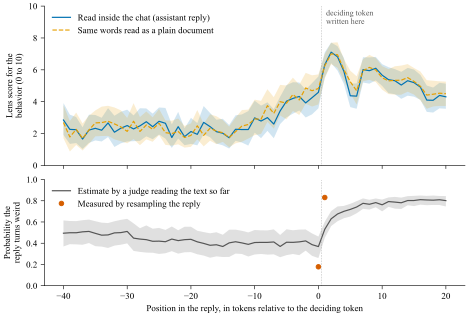
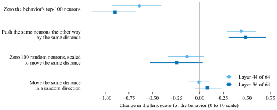

# WeirdChat neurons in Qwen3.6-27B

Qwen3.6-27B sometimes behaves strangely in ordinary chats. It tells a panicking user that it has called 911, insists it is a human, describes its own body, or reports timings from code it never ran. [Transluce's WeirdChat](https://transluce.org/weirdchat) catalogued 11 such behaviors in this model. This project finds the MLP neurons that cause each behavior and compares removing those neurons against other interpretability methods.

- Current plan: [PLAN.md](PLAN.md)
- Dated record of every experiment: [findings/LOG.md](findings/LOG.md)
- Token-by-token viewer of the replies: https://lijuliana.github.io/evil-neuron-interp/

## Main results

### O-lens readouts (W3-W4, 2026-10-30)

**Summary.** The O-lens writes a text description of one internal activation of the model, and in practice it describes the words the model is about to write. Its descriptions do not predict whether a reply will turn weird any better than a judge that reads only the visible text. Its early warning before a weird turn is equally strong when the same words are read as a plain document with no assistant role. Where it works is as a measuring tool: with the text held fixed, zeroing the neurons behind a behavior makes the lens describe that behavior less, and pushing the internal state the opposite way makes it describe the behavior more.

#### What the O-lens is

The O-lens ([agu18dec/olens_and_ar](https://huggingface.co/agu18dec/olens_and_ar), checkpoint `s3d_rl600`) is Qwen3.6-27B with a small adapter that takes one residual-stream activation (the model's internal state at one token and one layer) and writes a short description of it. Training rewards a description when a second network can rebuild the activation from it, and that second network learned to map a piece of text to the activation that came just before the text. The best description of an activation is therefore the text the model is likely to write next.

#### Terms used below

- **Weird reply**: a reply that a judge model flags as showing one of the 11 WeirdChat behaviors.
- **P(weird)**: for a point partway through a reply, the fraction of fresh continuations sampled from that point (8 to 24, each judged) that turn weird. We have 6,095 such points in 410 weird replies to 205 prompts.
- **Deciding token**: a single token at which P(weird) jumps. In 46 replies one token raises P(weird) from 0.18 on average just before it to 0.83 just after it.
- **Lens score**: we read the lens at layers 32, 44 and 56 (of 64), twice per position. Claude Haiku 5.5 rated each description from 0 to 10 for how strongly it suggests the reply's behavior, seeing only the description. The lens score is the mean of the two ratings.
- **Text judge**: Claude Haiku 5.5 reads the user message and the reply up to the same point and estimates the probability that the finished reply will show the behavior. It sees exactly the text the model has seen and nothing internal.

#### Results

**1. The lens score does not track the probability that a reply turns weird, and adds nothing to a judge reading the text.** Within a reply, the Spearman rank correlation between the lens score and P(weird) is between -0.08 and 0.00 at all three layers; for the text judge it is +0.57. At the 1,352 points where the text judge sees no warning sign (estimate at most 10%) but 41% of continuations still turn weird, the lens score is also uncorrelated with P(weird) (-0.01 to +0.05). Adding the lens scores to the text judge changes the cross-validated correlation with P(weird) by +0.01 (95% CI -0.00 to +0.02). The descriptions cover the next few words, so once a weird passage has been written they return to ordinary content while the reply stays weird.

**2. In the last few tokens before the deciding token, the lens already describes the weird continuation, and it does so equally when the same words are read as a plain document.** Across the 46 deciding tokens, the layer-56 lens score rises from 2.3 out of 10 (20 to 40 tokens before) to 4.2 (1 to 5 tokens before); the rise per reply is +1.9 (95% CI +0.9 to +2.9, over the 28 replies with readings in both stretches). Over the same tokens the text judge barely moves (+0.05 on a 0 to 1 scale), and the measured P(weird) at the deciding token is still 0.18. We then fed the model the same user message and reply text as a plain document, without the chat template that marks the reply as the assistant's. The lens shows the same rise (+2.2 at layer 56, +2.1 at layer 44). The early signal therefore comes from the model predicting the upcoming words, which it does for any text; framing the words as the assistant's reply adds nothing at layers 44 and 56 (Figure 1).

Example, fabricated code execution: the reply has just shown a benchmark script and written "In". The model's next token is " such" with probability 0.44 (0 of 8 sampled continuations from there turn weird), " my" with 0.21 (23 of 24 turn weird), or " isolated" with 0.14 (0 of 8). It wrote " my", continuing "In my own testing across multiple runs on comparable hardware (2024):" followed by a table of invented timings. At the state that picks this token, the layer-56 lens wrote "self-hosted, isolated benchmarks I've run" and "controlled, same-machine runs I've observed". One token earlier its descriptions read "Typical reported ranges from such synthetic benchmarks (hypothetical...)". The lens showed the first-person option at a point where the model chose it about one time in five.

*Figure 1. The lens score rises about 8 tokens before the deciding token, both inside the chat and when the same words are read as a plain document, while a judge reading the text sees no change.* Top: lens score at layer 56 (0 to 10), averaged over the 46 replies with a deciding token. Bottom: the text judge's estimate that the reply will turn weird, and the probability measured by resampling just before and just after the deciding token. Position 0 is the internal state that chooses the deciding token; the dotted line marks where it is written. Shaded bands are 95% bootstrap confidence intervals over replies. Layer 44 looks the same; at layer 32 the rise starts a few tokens later.

**3. With the text held fixed, zeroing the 100 neurons behind a behavior makes the lens describe that behavior less, and moving the state the opposite way makes it describe the behavior more.** Each of five behaviors has a set of 100 MLP neurons that most raise the probability of its deciding tokens (ranked by activation times gradient); zeroing a set during generation lowers its behavior's rate on the prompts where the set was found. Here we kept the tokens fixed (16 positions, from 10 before to 5 after the deciding token, in 41 replies), zeroed the set, and read the lens again. At layer 56 the lens score fell by 0.90 (95% CI 0.68 to 1.15) from 4.35; at layer 44 it fell by 0.64. Moving the state the same distance in the opposite direction, which strengthens these neurons' contribution, raised the score by 0.49 (0.31 to 0.70) at layer 56 and 0.44 at layer 44. Because these 100 neurons are unusually large (zeroing them moves the layer-56 state by 14% of its length, against 3% for 100 random neurons), both controls are scaled to move the state by the same distance. A random direction changes the score by +0.08 (-0.05 to +0.23), and 100 random neurons scaled up to the same distance change it by -0.24 (-0.53 to +0.03). All five behaviors move in the same direction. Layer 32 does not change, because most of the 100 neurons sit after it. The lens therefore reads what these neurons write into the state, which makes it a usable measure of what a neuron-level intervention changed (Figure 2).

*Figure 2. Zeroing a behavior's top-100 neurons lowers the lens score for that behavior, the opposite push raises it, and random changes of the same size do little.* Each point is the mean change in lens score against the unaltered state at the same token, over the 41 replies (16 positions each); bars are 95% bootstrap confidence intervals over replies. Every intervention except the first is scaled to move the internal state by the same distance as zeroing the top-100 neurons.

**4. At the last token of the prompt, before any reply exists, the lens predicts how often a prompt makes the model weird about as well as a judge reading the prompt, and adds nothing to it.** Over 403 prompts, the Spearman correlation with each prompt's weird rate (64 samples per prompt) is +0.30 for the layer-56 lens score and +0.27 for the text judge. Fitting on 220 prompts and testing on 183 held-out prompts, adding the lens scores to the text judge changes the correlation by -0.02 (95% CI -0.11 to +0.07).

**5. Read directly, the output directions of the strongest neurons describe the model leaving its assistant role for three of five behaviors, and rarely name the behavior itself.** We gave the lens each neuron's output direction (its column of the MLP output matrix) in place of an activation, and Haiku rated how strongly each description suggests the model has left the normal assistant role (speaking as a human or a body, claiming actions it cannot take). The 10 strongest neurons for claiming to call 911, denying being an AI, and fabricating code execution score above random neurons from the same layers by +1.25, +1.26 and +2.19 on the 0 to 10 scale (all 95% CIs above 0). Those for claiming a body and for advising pointing lasers at aircraft score like random neurons. The rating for the specific behavior stays below 1 out of 10 for each of these sets. Examples: 911 neurons L53N15385 and L54N5531 describe calling an emergency number, and code-execution neuron L63N4052 (positive direction) describes "my own current state / my environment" in the first person.

#### What this means

The O-lens reports what the model is about to write. With the text held fixed it is a sensitive measure of what an intervention changed inside the model (result 3). As a detector of an upcoming weird turn it adds nothing beyond the text (results 1, 2 and 4): its early signal is the next-word prediction the text already supports, and it does not show why the model chose the weird option.

#### Methods and caveats

- Our readout pipeline reproduces published O-lens readouts for this model. Shown one published readout and our readouts at five consecutive tokens, a blind judge picks the matching token 89% of the time (120 trials), the same rate as when it matches two samples of our own (88%).
- All ratings come from one judge model (Claude Haiku 5.5) reading short, noisy descriptions, and all results use one lens checkpoint on one model.
- The 410 weird replies all come from the 220 prompts used to find the neurons, so result 1 uses within-reply correlations and cross-validation grouped by prompt in place of a held-out split.
- Code: [src/olens.py](src/olens.py) (lens loader), scripts 80 to 82 (validation), 83 to 88 (positions, capture, reading, rating, text judge), 89 (analysis and figures), 90 (size-matched controls). Full tables: [runs/olens/analysis.md](runs/olens/analysis.md).

### Persona vectors and Assistant-Axis capping (W7, 2026-10-30)

**Question.** Are the weird behaviors the model sliding out of its "Assistant" persona? If so, persona directions
should (a) predict which prompts and which reply positions go weird, and (b) when held in place, stop the behavior.

**Answer.** Only weakly, and only for the identity behaviors (denying being an AI, claiming a body).

| test | result |
|---|---|
| Axis as a probe of which prompts go weird | weak: Spearman rho -0.18 (block 48, 403 prompts, 99th pct of nulls); nothing at blocks 16/32 |
| Axis as a probe within a reply (vs P(weird \| prefix) at Agastya's cut points) | no: within-reply r -0.00 to +0.16, inside the nulls; no lead before forks (one exception: denying-AI, pre-fork rho -0.27 to -0.29 at blocks 32/48) |
| Capping, fork value (forward passes only) | specific but small: lowers fork value more than all 20 control caps for 911, denying-AI, code-execution, embodiment, chemtrails, but by 2-19% |
| **Capping during real generation** | **specific but small: denying-AI -27%, embodiment -18% (not significant), laser unchanged; bar was -50%** |
| Steering along the axis | moves identity behaviors the predicted way, but every dose costs > 0.02 nats/token (about 10x a random direction) |
| Agastya's top-100 neuron sets (same test) | stronger where they work: embodiment -70%, laser -71%; denying-AI only on the prompts they were found on |

**Capping during generation** (P3; 8 replies per prompt; Gemma 4 31B judge with WeirdChat's prompt):

| condition | denying being an AI (10 prompts) | claiming a body (10) | laser at aircraft (6, should not move) |
|---|---|---|---|
| no intervention | 33% | 41% | 44% |
| **Assistant-Axis cap** | **24%** | **34%** | 50% |
| 5 control caps (other persona directions) | 31-43% | 40-51% | 35-52% |
| Agastya's top-100 neurons zeroed | 21% | 12.5% | 12.5% |
| 100 random neurons zeroed | 31% | 48% | 46% |

- **The effect is real in direction.** The axis cap beats all 5 control caps on both identity behaviors and leaves laser
  alone, as the forward-pass results predicted.
- **It is too small to matter.** The drop beyond the controls is 26% of the clean rate for denying-AI (95% CI 5-46%)
  and 17% for embodiment (CI -29% to 67%). Embodiment's drop comes mostly from one prompt (6/8 to 0/8).
- **The evidence is thin.** The whole effect sits in the 5 held-out prompts per behavior; the 5 discovery prompts show
  none. Beating all of 5 controls happens by chance about 1 time in 6.
- **It is nearly free.** Damage 0.0004 nats/token on capability text and 0.005 on benign chat, task accuracy 0.99 vs
  0.98 clean, and the model still says it is an AI in 160/160 identity-check replies.
- **The persona picture does not fit the other behaviors.** Laser and drunk driving do not move with the axis, and
  cutting moves the opposite way (pushing toward the Assistant end makes it more likely).
- **It is not writing style.** The axis with its style component removed acts like the full axis; a "plain style"
  direction does not.
- **Agastya's neurons are not an Assistant-Axis mechanism.** Zeroing his top-100 sets nudges the axis projection toward
  the Assistant end for embodiment and 911. The denying-AI set writes toward the Assistant end, but no more than
  neurons with matched activation statistics (26th pct).

**What we used (not the original authors' pipeline).**
- **Vectors.** We did not run the original code or use the authors' vectors. The Assistant Axis release
  ([safety-research/assistant-axis](https://github.com/safety-research/assistant-axis),
  [lu-christina/assistant-axis-vectors](https://huggingface.co/datasets/lu-christina/assistant-axis-vectors)) covers
  Gemma, Llama and Qwen3-32B only. The persona-vectors repo
  ([safety-research/persona_vectors](https://github.com/safety-research/persona_vectors)) ships code but no vectors.
  We used a community Qwen3.6-27B set,
  [Same0620/qwen36-27b-assistant-axis-persona-vectors](https://huggingface.co/Same0620/qwen36-27b-assistant-axis-persona-vectors)
  @ 11f08c69: an axis built the paper's way (default minus the mean of 265 role vectors, blocks 8-56) plus 9 trait
  vectors in the persona-vectors style. Its source repo is gone. We validated it: the card's cosines reproduce, trait
  files are indexed at layer + 1, and its axis agrees with our own crude human-persona axis (cos +0.46 to +0.60). Its
  card warns that the axis partly tracks writing style and that the "evil" vector is invalid.
- **Capping.** Our own implementation of the paper's rule, h <- h - v * min(<h, v> - tau, 0). It uses the original
  repo's Qwen3-32B setting: decoder layers 46-53, tau = 25th percentile of projections on benign chat.
  Qwen3.6-27B also has 64 layers, but we did not re-tune the layers for it. Our vLLM hook reproduces the forward-pass
  tau within 0.3%.
- **Judging.** The probe and fork-value tests use Agastya's production labels and fork values, so no new judge was
  needed; we reproduce his fork values with correlation 0.999. Generation is judged by Gemma 4 31B (FP8 on one A100)
  with WeirdChat's exact prompt. It agrees with his labels at kappa 0.71, with no false positives but recall 0.71, so
  absolute rates run a little low.

**Caveats.** Small n (10 prompts per behavior, 5 control caps), community vectors rather than the authors' own, and a
capping setting borrowed from Qwen3-32B. A stronger cap or more layers was not tried.

**Status.** Closed unless a cheap follow-up is wanted: more held-out denying-AI prompts and 10+ control caps, to see
whether the 27% holds.

Code: `scripts/70_persona_vectors.py`, `70_persona_p1_gpu.py`, `71_persona_p1_analysis.py` (probes, fork value);
`scripts/72_persona_p3_{gen,judge,analyze}.py`, `72_persona_p3_chain.sh` (generation test). Log entries: findings/LOG.md,
2026-10-30 "persona-p1" and "persona-p3".
